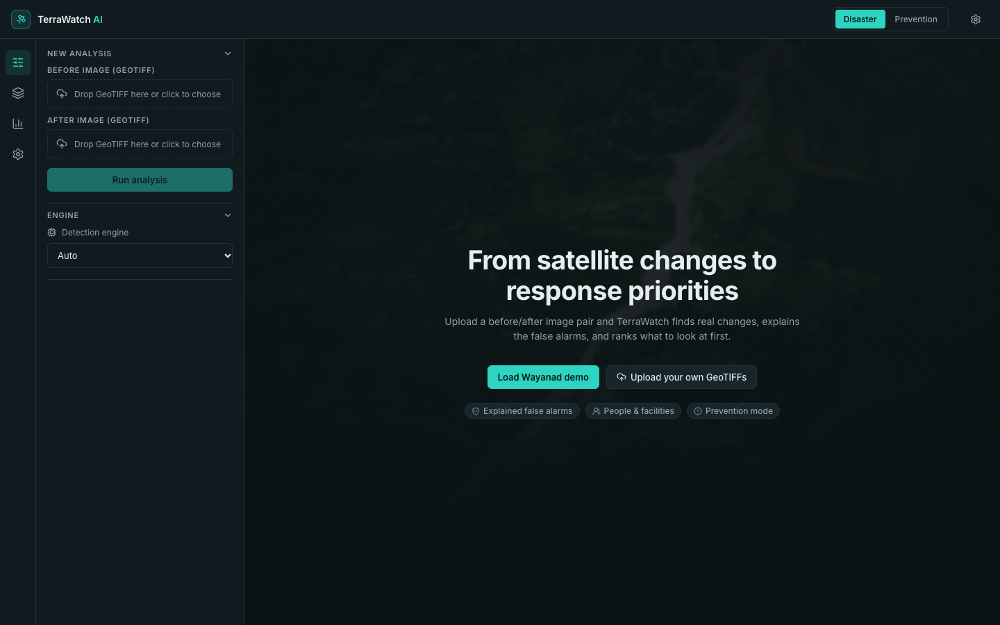
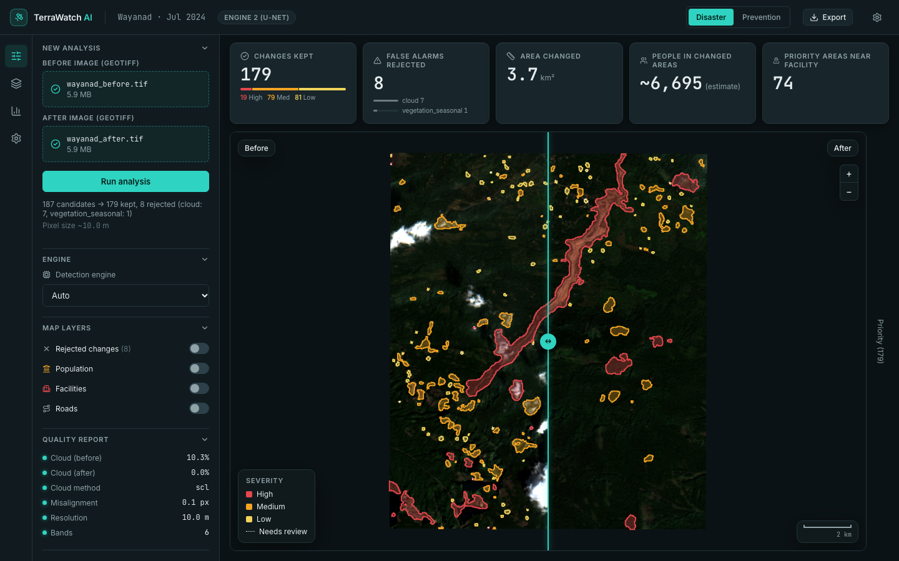
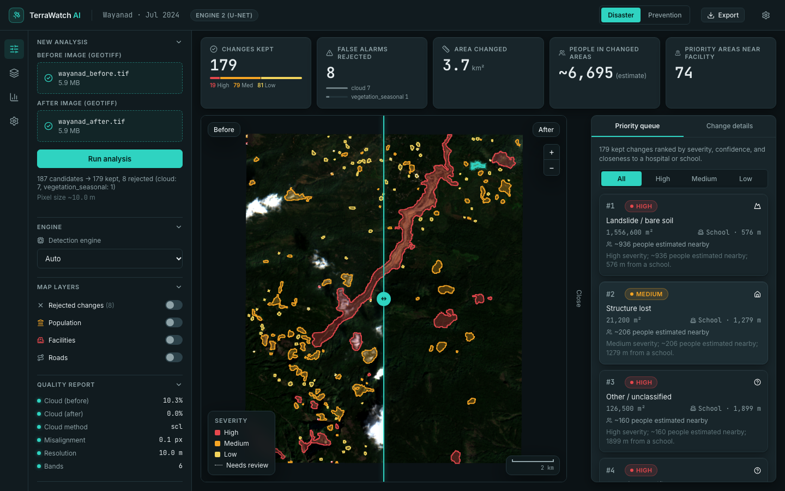
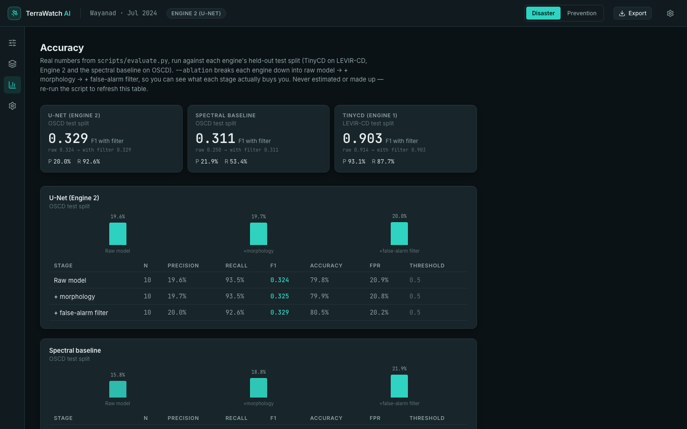
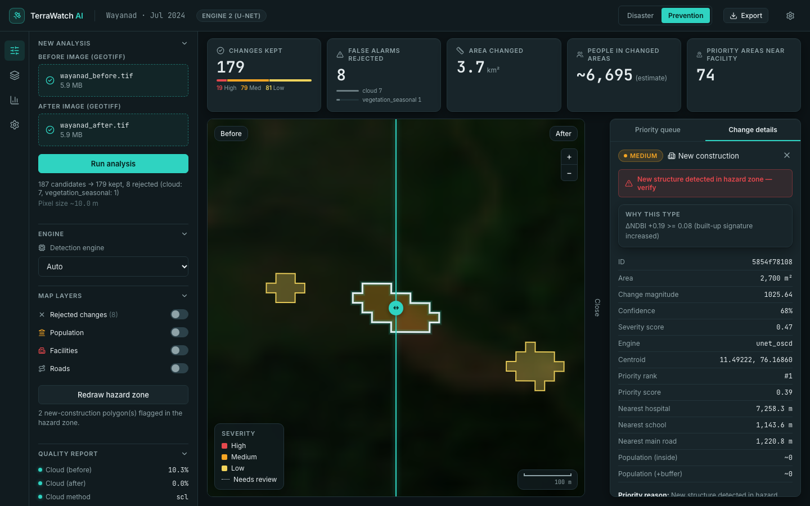
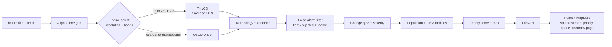

<div align="center">

# TerraWatch AI

**Satellite change intelligence for disaster response and urban planning**

[](https://github.com/divishapanjwani/terrawatch/actions/workflows/ci.yml)

[](LICENSE)

**Live demo:** _add link_ &nbsp;·&nbsp; **Demo video:** _add link_ &nbsp;·&nbsp; **Slides:** _add link_

</div>

TerraWatch takes two satellite images of the same place — **before** and
**after** — and automatically finds real changes (new or destroyed
buildings, floods, landslides), filters out fake ones (seasonal vegetation,
shadows, clouds), and turns what's left into map polygons with size,
severity, confidence, and priority. It's built for **disaster-response
teams and urban planners** who need to know where to look first and who is
likely affected, from imagery that arrives faster than anyone can manually
inspect it.

> Satellites capture imagery within hours. Responders can't inspect all of
> it. TerraWatch tells them which changes are real, why the rest aren't, and
> where people are likely to be affected — and the same engine flags risky
> construction before the next disaster.

## Screenshots

| Landing | Results — split-view map |
|---|---|
|  |  |

| Priority queue | Accuracy — real ablation table |
|---|---|
|  |  |

All four are the dark-UI build, running the real Wayanad demo pair — every
number on screen is live output, not a mockup.

---

## Problem statement requirements → implementation

Exact wording from the hackathon problem statement, left-to-right against
what actually implements it and how to check it yourself.

| Requirement | Status | Where | How to verify |
|---|---|---|---|
| Input: two co-registered, orthorectified GeoTIFF tiles covering the same bounding box | ✅ | `backend/app/geo/align.py::load_aligned_pair()` | Upload any two GeoTIFFs (any CRS/resolution) — the after image is resampled onto the before image's exact pixel grid regardless of input alignment. `pytest tests/test_geometry.py`; or upload `terrawatch-test-pair/before.tif` + `after_misaligned_3px.tif` to see the quality-check misalignment warning fire at exactly 3.0 px. |
| AI: Siamese CNN / ViT feature difference / spectral change index + lightweight U-Net | ✅ (two engines, both built) | Engine 1: `backend/app/engines/siamese.py` (pretrained **TinyCD** Siamese CNN, LEVIR-CD). Engine 2: `backend/app/engines/engine2.py` + `unet_model.py` (ΔNDVI/ΔNDWI/ΔNDBI spectral indices stacked into a lightweight U-Net, OSCD-trained). Auto-selected by `backend/app/engines/select.py::resolve_engine` | `GET /api/analyses/{id}` → `engine_key`. `docs/MODEL_CARD.md` for Engine 2's full spec. |
| Pixel-wise / feature-wise difference mapping | ✅ | `backend/app/engines/common.py::compute_magnitude_map`, engine probability maps | `change_magnitude` on every polygon in the export. |
| Morphological filtering to remove noise | ✅ | `backend/app/geo/morphology.py::clean_mask` (binary opening + closing) | `docs/EVALUATION.md` ablation table, "+ morphology" row. |
| Contour-to-polygon vectorization using Rasterio | ✅ | `backend/app/geo/vectorize.py::vectorize`, built on `rasterio.features.shapes` | Read the function, or inspect any exported polygon's geometry. |
| Attributed polygons: area (m²), change magnitude, centroid coordinate | ✅ | Same `vectorize()` — `area_m2` (always in a resolved **projected** CRS, never degrees), `change_magnitude`, `centroid_lat`/`centroid_lon` | Open any export's feature `properties`. |
| GIS-ready output: GeoJSON and GeoPackage, categorized into severity tiers | ✅ | `backend/app/geo/export.py::save_geojson`/`save_gpkg`; severity in `backend/app/pipeline/severity.py` | `GET /api/analyses/{id}/export?format=geojson\|gpkg` (kept **and** rejected polygons both included). |
| Interactive split-view (before/after) web map | ✅ | `frontend/src/map/CompareMap.tsx` — two synced MapLibre GL maps, draggable swipe divider, legend, scale bar, cursor coordinate readout | `make demo` → http://localhost:5173 → "Load Wayanad demo" → drag the swipe divider. |

All seven requirements are met as of Phase 2 of this build — everything
below is additional.

## Beyond the brief

| Feature | Where | What it does |
|---|---|---|
| False-alarm filter with explained reasons | `backend/app/pipeline/false_alarm.py` | Classifies every candidate as `kept`/`rejected` with one of 5 reasons (`cloud`, `too_small`, `misalignment_edge`, `vegetation_seasonal`, `shadow_illumination`); a toggleable "Rejected changes" map layer shows them grey-dashed, click for the plain-language reason. |
| Quality & pre-flight report | `backend/app/geo/quality.py` | Cloud % (Sentinel-2 SCL band or an RGB brightness heuristic), misalignment (phase cross-correlation), resolution, band count — shown as a quiet amber warning banner before results, never silent. |
| Dual-engine auto-selection with graceful fallback | `backend/app/engines/select.py` | Picks TinyCD vs. the OSCD U-Net by resolution + band count; falls back to a spectral-index baseline if a model's weights aren't downloaded — never crosses the resolution boundary "upward." |
| Estimated change-type labels | `backend/app/pipeline/change_type.py` | 6 rule-based types (`flooding`, `landslide_bare_soil`, `new_construction`, `structure_lost`, `vegetation_loss`, `other`) on kept polygons, with the exact firing rule shown (e.g. "ΔNDVI −0.13 ≤ −0.1, texture change 0.47 ≥ 0.35 on a 1,556,600 m² area"). |
| Social-impact layer: population + OSM facilities | `backend/app/impact/population.py`, `backend/app/impact/facilities.py` | Per-polygon population estimate (WorldPop raster, polygon + 250 m buffer), nearest hospital/school/shelter/main-road distances, all labeled "(estimate)". |
| Transparent priority queue | `backend/app/pipeline/priority.py`, `frontend/src/panels/PriorityPanel.tsx` | Ranked list with a weighted, inspectable score and a plain-language reason per item; weights are editable, not hardcoded. |
| Prevention mode / hazard zones | Click-to-draw on the map, `POST /api/analyses/{id}/hazard_zone` | Flags `new_construction` inside a user-drawn zone as *"New structure detected in hazard zone — verify"* (never "illegal") and ranks it first. |
| Editable settings | `backend/app/settings.py`, `frontend/src/pages/SettingsPage.tsx` | The five priority-score weights are editable in a Settings page, persisted to disk, applied to the next analysis. |
| Automated tests | `backend/tests/` (71 tests), `terrawatch-test-pair/check_results.py`, `backend/scripts/evaluate.py` | Unit tests for every geometry/severity/priority/false-alarm/change-type rule, a synthetic planted-answer-key acceptance test, and a real model-quality ablation — see `docs/EVALUATION.md`. |



*Prevention mode on the same Wayanad scene: a hand-drawn hazard zone flags the two `new_construction` polygons inside it with the required wording and re-ranks the selected one to #1 — the right panel shows every attribute, including the real nearest-hospital/school distances and the priority score that produced the ranking.*

## Architecture



Full module breakdown, API request/response examples, and the severity/
priority formulas: **`docs/ARCHITECTURE.md`**.

## Results

### Model-quality ablation (real numbers, `data/eval_results.json`)

| Engine | Dataset | Stage | Precision | Recall | F1 |
|---|---|---|---|---|---|
| Spectral baseline | OSCD test split | raw | 15.8% | 59.2% | 0.250 |
| Spectral baseline | OSCD test split | +morphology | 18.8% | 54.5% | 0.280 |
| Spectral baseline | OSCD test split | **+false-alarm filter** | **21.9%** | 53.4% | **0.311** |
| Engine 2 (U-Net) | OSCD test split | raw | 19.6% | 93.5% | 0.324 |
| Engine 2 (U-Net) | OSCD test split | +morphology | 19.7% | 93.5% | 0.325 |
| Engine 2 (U-Net) | OSCD test split | **+false-alarm filter** | **20.0%** | 92.6% | **0.329** |
| TinyCD | LEVIR-CD test split | raw | 92.9% | 89.9% | 0.914 |
| TinyCD | LEVIR-CD test split | +morphology | 92.9% | 89.8% | 0.914 |
| TinyCD | LEVIR-CD test split | +false-alarm filter | 93.1% | 87.7% | 0.903 |

Full table incl. accuracy/FPR, metric definitions, reproduction command, and
known failure cases: **`docs/EVALUATION.md`**.

### Case study: Wayanad landslide (Mundakkai/Chooralmala, 30 Jul 2024)

Sentinel-2 L2A, Engine 2 (U-Net) auto-selected, Disaster mode — these are
the exact numbers the screenshots above show, independently re-verified
against the live GeoJSON export for this README:

| Metric | Value |
|---|---|
| Candidates found | 187 |
| Kept (real changes) | **179** |
| Rejected (false alarms) | **8** — cloud: 7, seasonal vegetation: 1 |
| Severity distribution (kept) | **19 High** / 79 Medium / 81 Low |
| Largest change | landslide, **1,556,600 m²**, High severity, confidence 93.99%, ranked **#1** by priority |
| Landslide centroid | 11.486146°N, 76.151848°E |
| Estimated people in changed areas (+250 m buffer) | **~6,695** |
| Priority areas within 2 km of a hospital/school | **74** |

The cloud polygon that Phase 3 originally mis-flagged as "High severity"
(~4.89M m² at 11.453°N/76.159°E) is now correctly `rejected: cloud` at 97%
confidence using the Sentinel-2 SCL band — this is the single result the
false-alarm filter was built to fix, and it's shown exactly as computed, not
rounded or cherry-picked.

## Quick start

```bash
make setup   # backend venv + deps + TinyCD weights, frontend npm install,
             # wires up the committed Wayanad sample pair
make demo    # starts backend (:8000) + frontend (:5173) together
```

Open http://localhost:5173 and click **"Load Wayanad demo."**

```bash
make test    # 71 backend unit tests + frontend type-check/build
make eval    # re-run the model-quality ablation (needs LEVIR-CD/OSCD downloaded — see below)
```

Docker packaging was intentionally left out of this submission — there's
no Docker daemon in the environment this repo was prepared in, so a
docker-compose.yml here would be unverified, and this project's own rule is
"never invent/fake it." `make setup && make demo` is the tested path.

### Manual setup

<details>
<summary>Prerequisites, step-by-step backend/frontend setup, optional downloads</summary>

**Prerequisites:** Python 3.11 (not 3.13/3.14 — `rasterio`/`torch`/
`geopandas` don't ship wheels for the newest Python yet; macOS:
`brew install python@3.11`) and Node.js 20+.

**Backend:**

```bash
cd backend
python3.11 -m venv venv && source venv/bin/activate
pip install -r requirements.txt

mkdir -p models/tinycd
curl -L -o models/tinycd/levir_best.pth \
  https://github.com/AndreaCodegoni/Tiny_model_4_CD/raw/main/pretrained_models/levir_best.pth

uvicorn app.main:app --reload --port 8000
```

**Frontend:**

```bash
cd frontend && npm install && npm run dev
```

**Wayanad demo pair** (already committed — `sample_data/wayanad/`):

```bash
mkdir -p frontend/public/demo backend/data/wayanad
cp sample_data/wayanad/before.tif frontend/public/demo/wayanad_before.tif
cp sample_data/wayanad/after.tif  frontend/public/demo/wayanad_after.tif
cp sample_data/wayanad/before.tif backend/data/wayanad/before.tif
cp sample_data/wayanad/after.tif  backend/data/wayanad/after.tif
```

**Optional — train Engine 2** (auto-selection falls back to the spectral
baseline on Sentinel-2-class input without it):

```bash
mkdir -p data/oscd_raw && cd data/oscd_raw
curl -sL -o images.zip "https://hf.co/datasets/hkristen/oscd/resolve/main/Onera%20Satellite%20Change%20Detection%20dataset%20-%20Images.zip"
curl -sL -o train_labels.zip "https://hf.co/datasets/hkristen/oscd/resolve/main/Onera%20Satellite%20Change%20Detection%20dataset%20-%20Train%20Labels.zip"
curl -sL -o test_labels.zip "https://hf.co/datasets/hkristen/oscd/resolve/main/Onera%20Satellite%20Change%20Detection%20dataset%20-%20Test%20Labels.zip"
unzip -q images.zip -d images && unzip -q train_labels.zip -d train_labels && unzip -q test_labels.zip -d test_labels
cd ../.. && python scripts/train_oscd_unet.py   # ~4 min on Apple Silicon MPS
```

**Optional — population estimates** (skips gracefully, `population_available: false`, without it):

```bash
python scripts/download_population.py   # ~18 MB, WorldPop India 2020 1km
```

</details>

## Testing

```bash
cd backend && source venv/bin/activate && python -m pytest tests/ -v
```

**71 tests pass** — geometry/area math, severity scoring, engine
auto-selection, every false-alarm rule, every change-type rule, quality
checks, priority scoring, population sums.

```bash
curl "http://127.0.0.1:8000/api/analyses/<id>/export?format=geojson" -o export.geojson
python terrawatch-test-pair/check_results.py export.geojson
```

Geo-pipeline acceptance test against a synthetic answer key: **precision
0.73, recall 0.96, F1 0.83** (Engine = Spectral baseline; R1–R4 found,
seasonal vegetation correctly rejected). Full breakdown, model-quality
ablation, and known failure cases: **`docs/EVALUATION.md`**.

## Data sources and licenses

| Data | License | Used for |
|---|---|---|
| [Sentinel-2 L2A](https://planetarycomputer.microsoft.com/dataset/sentinel-2-l2a) via Microsoft Planetary Computer | ESA/Copernicus open data | Wayanad demo pair, auto-fetch |
| [OpenStreetMap](https://www.openstreetmap.org/copyright) via Overpass API | [ODbL](https://opendatacommons.org/licenses/odbl/) | Hospitals/schools/shelters/roads |
| [WorldPop](https://www.worldpop.org/) India 2020 1km population count | [CC BY 4.0](https://www.worldpop.org/data/licence/) | Population-affected estimates |
| [LEVIR-CD](https://justchenhao.github.io/LEVIR/) | Research/non-commercial | Engine 1 evaluation only — never georeferenced, never used for demo m²/coordinates |
| [OSCD](https://ieee-dataport.org/open-access/onera-satellite-change-detection-dataset) | Research use | Engine 2 training + evaluation |

**Model credit:** Engine 1 uses the pretrained **TinyCD** (`Tiny_model_4_CD`)
Siamese CNN by [Andrea Codegoni et al.](https://github.com/AndreaCodegoni/Tiny_model_4_CD),
trained on LEVIR-CD — see that repository for its own license. Engine 2 (the
OSCD U-Net) is trained from scratch in this repo — see `docs/MODEL_CARD.md`.

## Honesty rules (enforced in the product, not just this README)

- Change detection ≠ damage assessment — severity measures change
  *strength*, not confirmed damage.
- Every people-affected number is explicitly labeled "(estimate)".
- Hazard-zone construction is "flagged for verification," never "illegal."
- AI summaries (where implemented) may only restate computed facts, never
  add new ones.
- **Every number in this README was checked against a real, reproducible
  output** — `data/eval_results.json`, a live GeoJSON export, or
  `check_results.py` — not estimated or rounded for effect.

## Limitations and roadmap

- **RGB-only cloud detection is unreliable** — a brightness/whiteness
  heuristic cannot cleanly separate a bright cloud from a bright rooftop
  (see `docs/EVALUATION.md` §5). Real Sentinel-2 input isn't affected — it
  uses the actual SCL band.
- **Engine 2's precision ceiling (~20% on OSCD)** is the model's honest
  limit at ~2M parameters / 14 training scenes — see `docs/MODEL_CARD.md`.
- **Auto-fetch UI, LLM summaries/"ask the map", and alerts/field reports**
  from the original project brief (Phases 6–8) are not built in this
  submission — the one-off fetch scripts (`scripts/fetch_wayanad.py`,
  `scripts/fetch_real_test_pair.py`) and the core detection/trust/impact
  pipeline (Phases 1–5) are what this README documents and what's tested.
- **No containerized deployment** — see "Quick start" above for why; the
  Makefile path is the verified one.
- Editing priority weights in Settings applies to the **next** analysis,
  not a live recompute of whatever's already on screen (a deliberate
  simplification, not a bug).

Roadmap, in the order the original project brief specifies them: auto-fetch
UI (place name/bbox → best Sentinel-2 scenes), AI situation summaries
(EN/Hindi/Marathi) and "ask the map" natural-language filtering, field
feedback (confirmed/false-alarm buttons feeding back into thresholds),
Telegram alerts, PDF/HTML field reports, and route-blockage checking
(`route_impact`, already reserved at weight 0 in the priority formula).

## Repository structure

```
terrawatch/
  README.md  LICENSE  Makefile  .env.example  .github/workflows/ci.yml
  PROJECT_BRIEF.md            Original full spec
  HANDOFF.md                  Phase-by-phase build log (very detailed)
  CHANGELOG.md
  docs/
    ARCHITECTURE.md             Modules, API examples, formulas
    EVALUATION.md               Datasets, metrics, full ablation, failure cases
    MODEL_CARD.md               Engine 2 (U-Net) model card
    screenshots/
  sample_data/wayanad/        Committed demo GeoTIFFs (~11.8 MB)
  terrawatch-test-pair/       Synthetic answer-key pair + check_results.py
  backend/                    FastAPI app (Python 3.11) -- see docs/ARCHITECTURE.md
  frontend/                   React + Vite + TypeScript + MapLibre GL
```
