# Architecture

## Data flow

```mermaid
flowchart LR
    subgraph Input
        B[before.tif]
        A[after.tif]
    end

    B --> ALIGN[Align\napp/geo/align.py\nresample after → before's grid]
    A --> ALIGN

    ALIGN --> QUALITY[Quality check\napp/geo/quality.py\ncloud %, misalignment, resolution, bands]
    ALIGN --> SELECT[Engine selection\napp/engines/select.py\nresolution + band count → engine]

    SELECT -->|≤2 m/px, <5 bands| ENGINE1[Engine 1: TinyCD\nSiamese CNN, LEVIR-CD-trained]
    SELECT -->|coarser / multispectral| ENGINE2[Engine 2: U-Net\nOSCD-trained, 14 input channels]
    ENGINE2 -.fallback if no weights.-> SPECTRAL[Spectral baseline\nΔband-magnitude threshold]

    ENGINE1 --> PROBMAP[Change probability map]
    ENGINE2 --> PROBMAP
    SPECTRAL --> PROBMAP

    PROBMAP --> MORPH[Morphological filter\napp/geo/morphology.py\nopening + closing]
    MORPH --> VEC[Vectorize\napp/geo/vectorize.py\nrasterio.features.shapes → polygons → simplify]

    QUALITY --> FA
    VEC --> FA[False-alarm filter\napp/pipeline/false_alarm.py\nkept vs rejected + reason]
    FA --> CT[Change type\napp/pipeline/change_type.py\nKEPT polygons only]
    CT --> SEV[Severity\napp/pipeline/severity.py\nsev_score, High/Medium/Low]

    SEV --> IMPACT[Impact layer\napp/impact/population.py\napp/impact/facilities.py]
    IMPACT --> PRIORITY[Priority score\napp/pipeline/priority.py]

    PRIORITY --> EXPORT[Export\napp/geo/export.py\nGeoJSON + GeoPackage]
    EXPORT --> API[FastAPI\napp/api/analyses.py]
    API --> UI[React + MapLibre\nsplit-view map, priority queue,\naccuracy page, settings]
```



## Modules

| Path | Responsibility |
|---|---|
| `app/geo/align.py` | Resamples the after raster onto the before raster's exact pixel grid (CRS, transform, size). Everything downstream shares one grid. |
| `app/geo/quality.py` | Cloud % (Sentinel-2 SCL band, or an RGB brightness/whiteness heuristic), misalignment (phase cross-correlation), resolution, band count. Produces the per-pixel cloud masks the false-alarm filter uses. |
| `app/geo/features.py` | Per-pixel ΔNDVI / ΔNDWI / ΔNDBI, brightness-change fraction, texture-change fraction (Sobel gradient magnitude). |
| `app/geo/morphology.py` | Threshold → binary opening + closing on the probability map. |
| `app/geo/vectorize.py` | `rasterio.features.shapes` on the cleaned mask → shapely polygons → simplify → per-polygon attributes (area in a resolved projected CRS, change magnitude, confidence, centroid in EPSG:4326). Aggregates the `extra_maps` (NDVI/NDWI/NDBI deltas, texture, cloud overlap, edge proximity) per polygon for the false-alarm filter and change-type rules. |
| `app/geo/export.py` | Polygon list → GeoJSON (always EPSG:4326) and GeoPackage (native/area-projected CRS), both including kept **and** rejected polygons with every attribute. |
| `app/engines/select.py` | Chooses Engine 1 (TinyCD) vs Engine 2 (U-Net) vs the spectral baseline by resolution + band count; never falls back "upward" across the resolution boundary. |
| `app/engines/siamese.py` | Engine 1: tiled 256×256 inference (32px overlap) with a pretrained TinyCD (`Tiny_model_4_CD`) Siamese CNN, stitched by averaging. |
| `app/engines/engine2.py`, `app/engines/unet_model.py` | Engine 2: `SmallUNet` (14 input channels, ~1.95M params) trained on OSCD — see `docs/MODEL_CARD.md`. |
| `app/engines/spectral.py` | Fallback/comparison baseline: normalized band-difference magnitude, thresholded. |
| `app/pipeline/false_alarm.py` | Classifies every candidate as `kept` or `rejected` with a `reject_reason` (priority order: `too_small` → `cloud` → `misalignment_edge` → `vegetation_seasonal` → `shadow_illumination` → else kept). |
| `app/pipeline/change_type.py` | For KEPT polygons only: estimates `flooding` / `landslide_bare_soil` / `new_construction` / `structure_lost` / `vegetation_loss` / `other`, rule-based on the index deltas, with the firing rule recorded in `change_type_rule`. |
| `app/pipeline/severity.py` | `sev_score` and the High/Medium/Low tier — see formula below. |
| `app/impact/population.py` | Sums a WorldPop population-count raster inside each polygon (and inside a 250 m buffer). Skips gracefully (`population_available: false`) if the raster file isn't present — never invents a number. |
| `app/impact/facilities.py` | Hospitals/clinics/schools/shelters/main roads from OpenStreetMap via the Overpass API, disk-cached by bounding box. |
| `app/pipeline/priority.py` | `priority_score`, `priority_rank`, `priority_reason`, and hazard-zone re-ranking for Prevention mode — see formula below. |
| `app/pipeline/run.py` | Orchestrates the whole sequence above and assembles the result dict the API persists. |
| `app/pipeline/ablation.py` | Reconstructs the three ablation stages (raw / +morphology / +false-alarm filter) on plain, non-georeferenced LEVIR-CD/OSCD images for `scripts/evaluate.py`. |

## API endpoints

All routes are prefixed `/api`. Full request/response models live in `app/api/analyses.py` and `app/api/settings.py`.

### `POST /api/analyses`

Upload a before/after GeoTIFF pair and start a background analysis.

```bash
curl -X POST http://127.0.0.1:8000/api/analyses \
  -F "before=@sample_data/wayanad/before.tif" \
  -F "after=@sample_data/wayanad/after.tif" \
  -F "mode=disaster" \
  -F "engine=auto"
```

```json
{ "analysis_id": "c1d0d072e88e" }
```

### `GET /api/analyses/{id}`

Poll status, progress step, and the quality report.

```json
{
  "id": "c1d0d072e88e",
  "status": "ready",
  "progress_step": "done",
  "progress_steps": ["validating", "quality_check", "detecting", "filtering", "vectorizing", "impact_analysis", "done"],
  "engine": "unet_oscd",
  "engine_key": "engine2",
  "engine_fell_back": false,
  "polygon_count": 179,
  "kept_count": 179,
  "rejected_count": 8,
  "reject_reason_counts": { "cloud": 7, "vegetation_seasonal": 1 },
  "summary_line": "187 candidates → 179 kept, 8 rejected (cloud: 7, vegetation_seasonal: 1)",
  "population_available": true,
  "total_population_buffer_est": 6695.3,
  "near_facility_count": 74,
  "quality_report": { "cloud_pct_before": 2.1, "cloud_pct_after": 6.4, "misalignment_px": 0.0, "cloud_method": "scl" }
}
```

### `GET /api/analyses/{id}/polygons`

The full kept + rejected GeoJSON `FeatureCollection` (same content as the GeoJSON export).

### `GET /api/analyses/{id}/facilities`

Hospitals/schools/shelters/roads for the map's Facilities/Roads layers (reads the same on-disk Overpass cache populated during analysis).

### `GET /api/analyses/{id}/imagery/{before|after|population}`

Returns a PNG — the aligned before/after preview, or the colorized population-density overlay (404 if population data wasn't available).

### `POST /api/analyses/{id}/hazard_zone`

Apply a user-drawn Prevention-mode hazard zone to an already-ready analysis. Recomputes `in_hazard_zone` and re-ranks directly from the saved result files — no re-detection, no re-fetch of facilities/population.

```json
{ "geojson": { "type": "Polygon", "coordinates": [[[76.168, 11.491], [76.169, 11.492], [76.170, 11.491], [76.168, 11.491]]] } }
```

```json
{ "status": "ok", "in_hazard_zone_count": 2 }
```

### `GET /api/analyses/{id}/export?format=geojson|gpkg`

Downloads the GeoJSON (EPSG:4326) or GeoPackage (native/area CRS) export.

### `GET/POST /api/settings/weights`

Read or edit the five priority-score weights (`w1_severity` … `w5_route_impact`), persisted to `data/settings.json` and applied to the **next** analysis.

### `GET /api/metrics`

Returns `data/eval_results.json` — the ablation table the Accuracy page renders.

## Severity formula

```
sev_score = max(norm(log1p(area_m2)), norm(log1p(change_magnitude)))
High ≥ 0.66, Medium ≥ 0.33, else Low
```

`norm()` is min-max normalization **within the current analysis's kept polygons** (so a scene with only small changes still has a "biggest" one). Two deliberate choices, both fixing a real failure mode observed on Wayanad (a 1.56M m² landslide, by far the largest kept polygon, originally scored only "Medium" under a plain linear-average formula):

- **`log1p` before normalizing** — polygon areas can span 3+ orders of magnitude in one analysis; without log-scaling, one huge outlier compresses every other real, substantial change toward zero.
- **`max()`, not an average** — a change is severe if it is either very large *or* very intense; it shouldn't need to be both to earn High.

See `app/pipeline/severity.py` for the full docstring and `app/config.py` for the tier thresholds.

## Priority formula

Disaster mode:

```
priority_score = w1·sev_score + w2·norm(population_est) + w3·facility_proximity
                + w4·confidence + w5·route_impact
```

- `facility_proximity = max(closeness(nearest_hospital_m), closeness(nearest_school_m))`, where `closeness(d) = clamp(1 − d / 2000, 0, 1)` (1.0 right next to a facility, 0 at or beyond 2 km).
- `route_impact` is reserved (weight `w5 = 0.0` by default) — not implemented in this build.
- Default weights: `w1=0.35, w2=0.25, w3=0.2, w4=0.2, w5=0.0` (`app/config.py`), editable via `GET/POST /api/settings/weights` and the Settings page.
- `priority_reason` is a generated sentence citing severity, the people estimate (if available), and whichever of hospital/school is nearer.

Prevention mode: polygons are sorted the same way, except any `new_construction` polygon with `in_hazard_zone = true` is placed first (banner text: *"New structure detected in hazard zone — verify"*, never "illegal").

See `app/pipeline/priority.py`.
